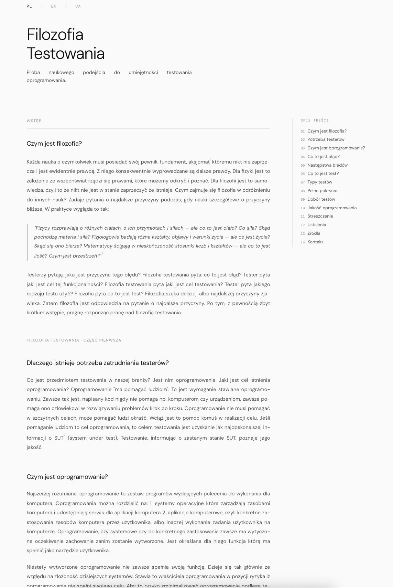

# testofilos

Philosophy of testing / Filozofia testowania / Філософія тестування.

**Live Site:** [filoqa](https://pawel-zygler.github.io/testofilos/)



---

## Layout & Design

The site uses a clean, editorial layout inspired by long-form publications:
- **Typography:** DM Sans + DM Mono for a clean, aesthetic reading experience.
- **Justified Text:** Paragraphs, blockquotes, and lists are justified (`text-align: justify;` with hyphens) to ensure neat margins without ragged edges.
- **Structure:** Two-column grid with a sticky right sidebar featuring a Table of Contents.
- **Multilingual:** Interactive toggle for Polish (PL), English (EN), and Ukrainian (UA) content with language-aware hyphenation.

---

## Usage

Open `index.html` in any browser:

```bash
open index.html
```

---

## Testing

End-to-End and accessibility tests with Playwright & TypeScript.

- [Test Plan](docs/test-plan.md)
- [Test Scenarios](docs/test-scenarios.md)
- [Test Strategy](docs/test-strategy.md)

```bash
npm test            # Run all tests
npm run test:smoke  # Smoke tests (Deployment Blocker)
npm run test:a11y   # Accessibility WCAG (Deployment Blocker)
npm run report      # View HTML test report
```

---

## Changelog

Detailed release history and notable changes can be found in [CHANGELOG.md](CHANGELOG.md), which adheres to the [Keep a Changelog](https://keepachangelog.com/en/1.1.0/) format.
