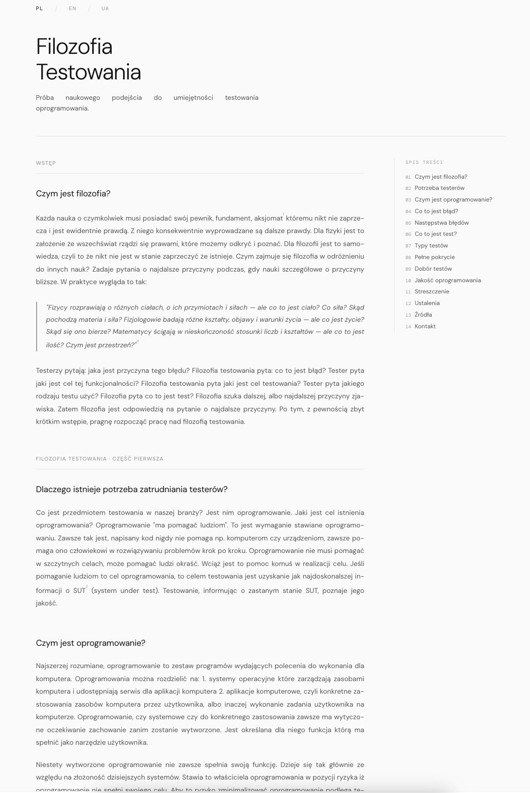

# Filozofia testowania

Philosophy of testing / Filozofia testowania / Філософія тестування.

**Live Site:** [testofilos.pages.dev](https://testofilos.pages.dev/)



---

<details>
<summary><b>Playwright Test Automation</b></summary>

End-to-End and accessibility tests with Playwright & TypeScript.

- [Test Plan](docs/test-plan.md)
- [Test Scenarios](docs/test-scenarios.md)
- [Test Strategy](docs/test-strategy.md)

```bash
npm run serve       # Build _site/ and serve it on http://localhost:8080
npm test            # Run all tests (against the built _site/)
npm run test:smoke  # Smoke tests (Deployment Blocker)
npm run test:a11y   # Accessibility WCAG (Deployment Blocker)
npm run report      # View HTML test report
BASE_URL=https://testofilos.pages.dev npm run test:smoke  # Smoke test a deployed site
```

</details>

---

<details>
<summary><b>Build & Deployment</b></summary>

- `index.html` is the whole site; static assets (fonts, favicon, social preview image, 404 page) live in `public/`.
- `npm run build` copies only these public files to `_site/` and generates the Cloudflare Pages `_headers` file (security headers, CSP with the hash of the inline script, cache rules). Edit `index.html`, never `_site/`.
- GitHub Actions (`.github/workflows/deploy.yml`) runs the tests, then deploys `_site/` to Cloudflare Pages: production from `main`, a preview URL for every pull request. Each deployment is smoke-tested.
- The old GitHub Pages address (`https://pawel-zygler.github.io/testofilos/`) only redirects to the new site (see `redirect/`).
- Required repository secrets: `CLOUDFLARE_API_TOKEN` (permission: Account → Cloudflare Pages → Edit) and `CLOUDFLARE_ACCOUNT_ID`.

</details>

---

## Changelog

Detailed release history and notable changes can be found in [CHANGELOG.md](CHANGELOG.md), which adheres to the [Keep a Changelog](https://keepachangelog.com/en/1.1.0/) format.
